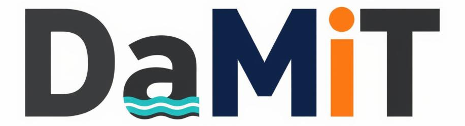

  <picture>
    <source media="(prefers-color-scheme: dark)" srcset="docs/img/damit-wordmark-dark.png">
    
  </picture>

<b>Dam hazard screening, breach modeling and hazard classification for QGIS, anywhere in the US.</b>

DamIT is a set of QGIS plugins (QGIS 3.28 to 4.x) that take a dam from the
[National Inventory of Dams](https://nid.sec.usace.army.mil/) to a **suggested** hazard class:
it screens the dam, models a breach flood, and scores what the water reaches against your state's or
agency's rules (19 presets, or pick your own methods). It is the US-wide sister of the North Dakota
DamSafety plugins and shares their engine.

> **Suggestions, not determinations.** The engineer of record and the regulating agency make the call.

## Get started

1. **Install.** Easiest: the one-step installer in [`suite_install/`](suite_install/README.md)
   (Windows, Linux, macOS; no admin rights). It sets up QGIS, the flood models and the plugins.
   Or build the plugin zips yourself with `python3 scripts/package_plugins.py dist/` and install them in
   QGIS (*Plugins → Install from ZIP*): **DamIT Core first, then DamIT Catalog, then the rest.**
2. **Open *Plugins → DamIT → Start here*** (DamIT Setup). Pick your state and data folder.
3. **Get data.** *DamIT Data* downloads buildings, roads, rail and facilities for your state.
4. **Screen → Run → Classify.** Screener checks the dam and makes a quick flood; Runner models the full
   breach; Hazard reads the flood maps and gives the suggested class with a report naming why.

## What's in the box

| Part | What it does for you |
|---|---|
| **Setup** | Start here: folders, state, checks that everything is installed |
| **Data** | Downloads national data (structures, roads, rail, bridges, facilities) |
| **Screener** | Quick check of a dam and a fast screening flood |
| **Runner** | Full breach flood with LISFLOOD-FP or ANUGA |
| **Hazard** / **Hazard Lite** | Suggested hazard class from the flood maps |
| **Catalog** | Every state/agency rule as data, editable without a new release |
| **PMP** | NOAA Atlas 14 rainfall tables and grids |
| **Finder** | Finds dams, ponds and culverts that are not on any list (a review list) |
| **Crest** | Desktop app: draw a dam, size the breach, see the flood map |
| **Core** | Shared code the others need |
| [`damit_ai/`](damit_ai/README.md) | Two optional local AI helpers (below) |

Full details of every tool, setting and file: [docs/REFERENCE.md](docs/REFERENCE.md).

## Models used, and where they come from

**Local AI helpers** (optional, run on your own computer through [Ollama](https://ollama.com); nothing leaves the machine).
*Heim* helps triage plugin code and failed runs; *Vor* answers questions from dam-safety papers
with page citations. Both are assistants, not engineers. The installer picks the model by your computer's memory.

| Model (Ollama tag) | Used by | Made by | Downloaded from | License |
|---|---|---|---|---|
| `qwen3:30b-a3b`, `qwen3:14b`, `qwen3:8b` | Heim, Vor (chat) | Alibaba Qwen | Ollama library; fallback Hugging Face [`Qwen/Qwen3-*-GGUF`](https://huggingface.co/Qwen) | Apache-2.0 |
| `qwen3:4b` | Heim run-watcher | Alibaba Qwen | Ollama library; fallback [`Qwen/Qwen3-4B-GGUF`](https://huggingface.co/Qwen/Qwen3-4B-GGUF) | Apache-2.0 |
| `qwen3.6:35b-a3b`, `qwen3.6:27b` | Vor on 32–48 GB+ machines | Alibaba Qwen | Ollama library ([Qwen3.6 on Hugging Face](https://huggingface.co/Qwen)) | Apache-2.0 |
| `phi4-mini` (alternative) | Heim run-watcher | Microsoft | Ollama library; fallback [`unsloth/Phi-4-mini-instruct-GGUF`](https://huggingface.co/unsloth/Phi-4-mini-instruct-GGUF) | MIT |
| `qwen3-embedding:0.6b` | Vor (search index) | Alibaba Qwen | Ollama library | Apache-2.0 |
| `nomic-embed-text` (v1.5) | Heim (search index); Vor fallback | Nomic AI | Ollama library; fallback [`nomic-ai/nomic-embed-text-v1.5-GGUF`](https://huggingface.co/nomic-ai/nomic-embed-text-v1.5-GGUF) | Apache-2.0 |

Hugging Face fallbacks are checked against a pinned SHA-256. No model weights are stored in this repository.

**Flood and terrain models** (installed by `suite_install/`, pinned by version and SHA-256):
[LISFLOOD-FP 8.3](https://zenodo.org/records/13121119) (University of Bristol, GPL-3.0; source from Zenodo, built or shipped as a binary),
[ANUGA 4.1](https://github.com/anuga-community/anuga_core) (Geoscience Australia / ANU, Apache-2.0),
[gmsh 4.15](https://gmsh.info) (GPL-2.0-or-later), [QGIS 3.34](https://qgis.org) (GPL-2.0-or-later), all from conda-forge.
The **Finder score** is DamIT's own model (bagged boosted trees, written in this repository; no outside model or weights). A starter is shipped in `damit_finder/models/`: learned from North Dakota's dam list on USGS 1 m LiDAR and checked on Iowa pond dams (AUC 0.89). Relearn it from your own state's dam list with the score tool.

**Data** (downloaded by you, not stored here): USACE NID and NSI, USGS 3DEP elevation and 3DHP streams,
Microsoft Building Footprints, OpenStreetMap (© OpenStreetMap contributors, ODbL), FEMA/ORNL USA Structures,
FHWA HPMS and NBI, FRA rail, Census TIGER, HIFLD, NLCD, NOAA Atlas 14. Sources and citations are written into
every run. Credits for everything else DamIT builds on: [docs/THIRD-PARTY.md](docs/THIRD-PARTY.md).

## License

DamIT is **multi-licensed** — see **[LICENSING.md](LICENSING.md)** for the authoritative map:

- The **QGIS plugins** are **GPL-3.0-or-later** (they load inside QGIS, which is GPL).
- The standalone **Crest app** and **AI tools** are **PolyForm Noncommercial 1.0.0** (free for non-commercial use; commercial use needs permission).
- Every bundled/downloaded third-party component keeps its own license ([docs/THIRD-PARTY.md](docs/THIRD-PARTY.md)).
- The **DaMiT** name and logo are not covered by any code license; all rights, including trademark, reserved.
